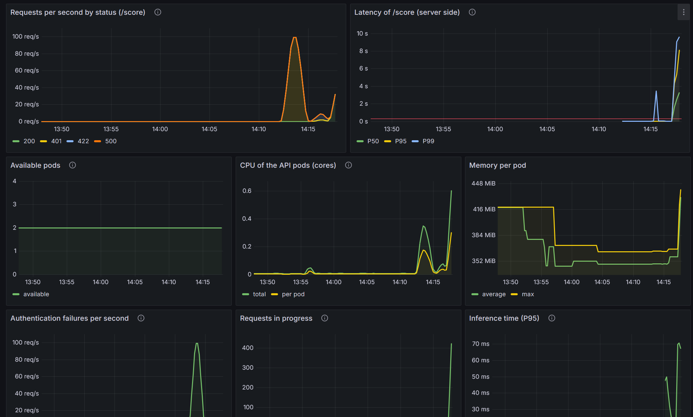
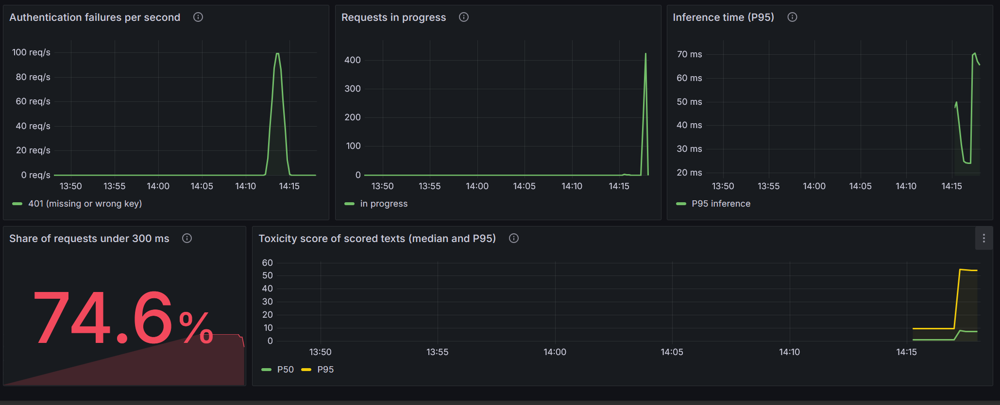
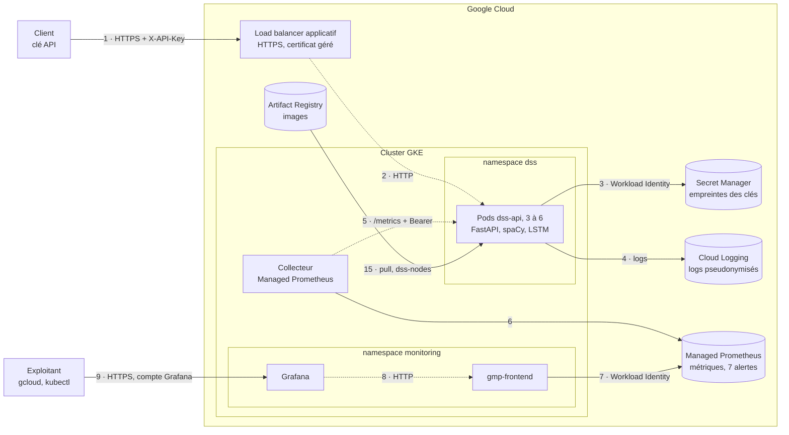
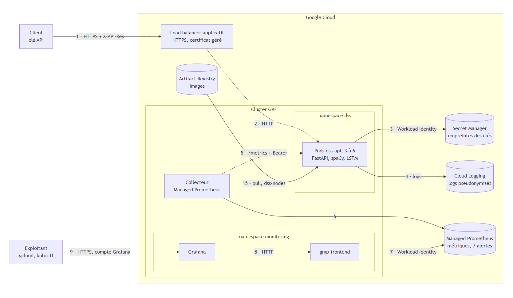
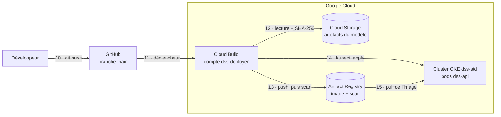
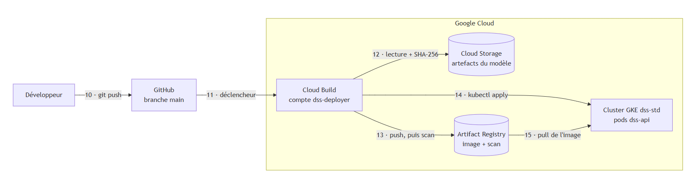
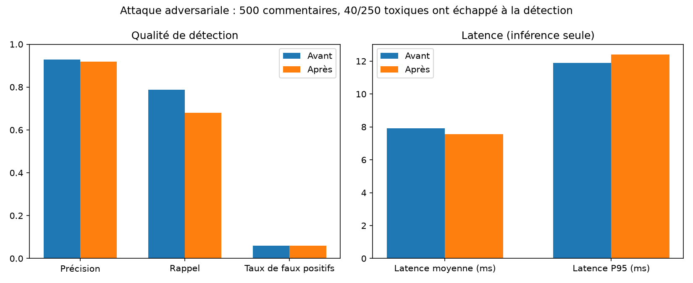
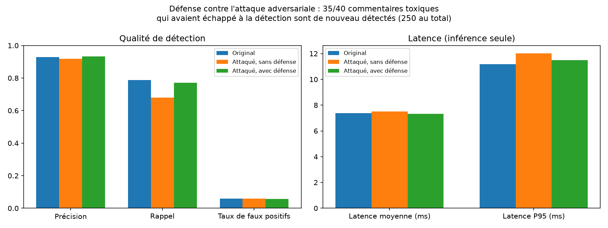

# Digital Social Score

API qui évalue la toxicité d'un commentaire en anglais (insultes, menaces, propos haineux) et renvoie un verdict :
`clean`, `slightly_toxic` ou `toxic`. Le texte est anonymisé avant d'atteindre le modèle (LSTM), n'est jamais
stocké, et l'API tourne sur Google Kubernetes Engine derrière un load balancer HTTPS.

**En production :** <https://136-81-21-137.sslip.io> (page de test sur `/`, clé API demandée pour `/score`).

```
POST /score   {"text": "You are a stupid idiot"}   ->   {"verdict": "toxic", "request_id": "..."}
```

## Plan

| | Sujet | Section |
|---|---|---|
| TP1 | Anonymisation (NER spaCy) et registre RGPD | [Exercice 1](#exercice-1) |
| TP1 | Nettoyage et comparaison LSTM / BERT / LAYA | [Exercice 2](#exercice-2) |
| TP1 | Déploiement de l'API sur GKE | [Exercice 3](#exercice-3) |
| TP1 | Authentification, IAM, chiffrement, RGPD | [Exercice 4](#exercice-4) |
| TP1 | Tests de charge (k6) et améliorations | [Exercice 5](#exercice-5) |
| TP1 | Supervision Prometheus / Grafana, attaques, grille de tests | [Exercice 6](#exercice-6) |
| TP1 | Schéma d'architecture et zero trust | [Exercice 7](#exercice-7) |
| TP2 | Attaque adversariale, défense, IA Act, DevSecOps, analyse critique | [TP 2](#tp-2--de-la-menace-à-la-défense) |

## Exécution

**Prérequis :** Python 3.14 et [uv](https://docs.astral.sh/uv/). Pour le déploiement : `gcloud`, `kubectl` et un
projet Google Cloud.

**Installer les dépendances :**

```powershell
uv sync
```

**Récupérer le modèle.** Les artefacts (`models/lstm/`, 27 Mo) ne sont pas dans le dépôt. Les copier depuis le bucket
du projet, ou les produire avec le notebook d'entraînement (`src/tp1_digital_social_score/train.ipynb`, voir
l'Exercice 2) :

```powershell
gcloud storage cp "gs://tp1-digital-score-models/lstm/*" models/lstm/
grep -v '^#' model-artifacts.sha256 | sha256sum --check -   # Git Bash : empreintes attendues
```

**Lancer l'API en local** (PowerShell) : une clé est générée, son empreinte est donnée à l'API, la clé elle-même
sert à l'appeler.

```powershell
$out = uv run python -I -m tp1_digital_social_score.security generate dev
$env:API_KEYS = $out[1]
uv run uvicorn tp1_digital_social_score.api:app --port 8080
```

Dans un second terminal (page de test : <http://localhost:8080/>, documentation : <http://localhost:8080/docs>) :

```powershell
curl.exe -X POST http://localhost:8080/score -H "X-API-Key: $($out[0])" -H "Content-Type: application/json" -d '{\"text\": \"You are a stupid idiot\"}'
```

**Contrôles qualité** (les mêmes que le pipeline) :

```powershell
uv run ruff check src/ tests/ attack/ compliance/ ci/
uv run mypy src/ tests/ ci/
uv run pytest tests/ -q
```

**Déployer :** chaque push sur `main` lance le pipeline Cloud Build ([`cloudbuild.yaml`](cloudbuild.yaml)), qui teste,
construit, scanne et déploie (TP2, Exercice 5). La mise en place initiale du projet Google Cloud (cluster, IAM,
secrets, supervision, pipeline, HTTPS) est décrite pas à pas dans [`step_deployment.md`](step_deployment.md).

**Reproduire les mesures :** les données Jigsaw se téléchargent avec `uv run --group train python -I -m
tp1_digital_social_score.load_data` (jeton Kaggle dans `.env`, créé depuis `.env.example`). Les commandes de chaque
mesure (attaque, défense, biais, charge) sont données dans leur section.

## Organisation du dépôt

| Dossier ou fichier | Contenu |
|---|---|
| `src/tp1_digital_social_score/` | Code de l'API (`api.py`), pipeline de texte, défense, verdict, sécurité, notebook d'entraînement |
| `tests/` | Tests unitaires et d'intégration (pytest) |
| `k8s/`, `monitoring/` | Manifests Kubernetes de l'API (dont HTTPS) et de la supervision (Grafana) |
| `loadtest/` | Scénarios k6 et résultats des tests de charge |
| `attack/` | Attaque adversariale, défense mesurée, rapport d'attaque d'une autre équipe |
| `compliance/` | Mesure du biais (IA Act) |
| `ci/` | Contrôle de vulnérabilités du pipeline et log d'exécution |
| `docs/` | Schémas d'architecture et captures Grafana |
| `cloudbuild.yaml`, `Dockerfile` | Pipeline DevSecOps et image de l'API |
| `model_card.json`, `model-artifacts.sha256` | Fiche du modèle (IA Act) et empreintes des artefacts |
| `step_deployment.md` | Toutes les commandes de déploiement, dans l'ordre |

# Exercice 1

## Comparer la version originale et la version anonymisée et justifier chaque choix

Exemple :

> *Your vandalism to the Matt Shirvington article has been reverted.*
> → *Your vandalism to the **[PERSON]** article has been reverted.*

| | Originale | Anonymisée |
|---|---|---|
| E-mails, adresses IP, URL, téléphones | en clair | `[EMAIL]`, `[IP]`, `[URL]`, `[PHONE]` |
| Noms et lieux | en clair | `[PERSON]`, `[GPE]`, `[LOC]`, `[FAC]` |
| Structure des phrases | intacte | intacte (espace réservé à la place de la valeur) |
| Insultes et groupes ciblés (`NORP`) | présents | conservés |
| Étiquettes de toxicité | inchangées | inchangées |

| Choix | Justification |
|---|---|
| Regex pour les e-mails, IP, URL et téléphones | Formats fixes : les regex sont donc plus fiables qu'un modèle statistique. Les adresses IP identifient directement les contributeurs Wikipédia non connectés. |
| NER de spaCy pour les noms et les lieux | Il n'existe pas de format fixe ; le contexte de la phrase est nécessaire. Ce sont les données personnelles les plus fréquentes du corpus. |
| Espaces réservés typés, plutôt que suppression | `[PERSON]` conserve la grammaire, ce qui suffit pour évaluer la toxicité. Supprimer le mot casserait la phrase. |
| Absence de table de correspondance | La réidentification est impossible : il s'agit d'une véritable anonymisation, conforme au principe de minimisation des données (RGPD, art. 5.1.c). |
| `NORP` et `ORG` conservés | Les commentaires racistes ciblent des groupes (nationalités, religions) ; les supprimer ferait disparaître le signal que le modèle doit apprendre. Ils désignent des groupes, et non une personne identifiable. `ORG` ne constitue pas une donnée personnelle. |
| Étiquettes et `id` inchangés | Ils sont nécessaires à l'entraînement ; `id` est un hash sans signification en dehors du jeu de données. |

## Registre des activités de traitement (RGPD, art. 30)

| Rubrique | Entrée |
|---|---|
| **Nom et référence** | TRT-001, « Digital Social Score : préparation du jeu de données d'entraînement à la toxicité (anonymisation des commentaires) » |
| **Finalité(s)** | Entraîner et évaluer un modèle qui évalue la toxicité d'un texte (insulte, racisme, harcèlement, discours haineux) dans le cadre d'un projet pédagogique. |
| **Base légale (par finalité)** | Intérêt légitime (entraînement d'une IA, tel qu'accepté par la CNIL), documenté par le test en trois étapes : finalité légitime (détecter les contenus toxiques) ; nécessité (commentaires publics, identifiants supprimés avant l'entraînement) ; mise en balance (aucune donnée sensible ciblée, aucun profilage de personnes). |
| **Catégories de personnes concernées** | Contributeurs Wikipédia ayant écrit les commentaires ; tiers mentionnés dans les commentaires. |
| **Catégories de données** | Texte libre (`comment_text`) pouvant contenir des noms, pseudonymes, adresses IP, e-mails, URL, numéros de téléphone et lieux ; identifiant du commentaire (hash) ; étiquettes de toxicité. |
| **Données sensibles (art. 9) ?** | Elles ne sont pas ciblées, mais le texte libre peut révéler des opinions politiques, une religion ou une origine. Risque résiduel : les groupes (`NORP`) sont conservés volontairement et le NER peut manquer certaines mentions. |
| **Destinataires (internes / externes)** | Internes : équipe du projet et enseignant. Externes : aucun. |
| **Sous-traitants (DPA signé ?) ** | Aucun à ce stade (traitement local). Un fournisseur cloud devra faire l'objet d'un DPA avant tout téléversement. |
| **Durée de conservation (active / archive)** | Originaux (`raw_data/`) : conservés uniquement pendant l'étape d'anonymisation, puis supprimés. Fichiers anonymisés : conservés pendant la durée du projet, puis supprimés. Aucune archive intermédiaire. La suppression couvre également les sauvegardes, les jeux de données ML et les exports temporaires. |
| **Transferts hors de l'UE** | Source hébergée par Kaggle (États-Unis) ; les fichiers sont stockés localement dans l'UE. Aucun autre transfert. |
| **Mesures de sécurité** | Identifiants supprimés avant l'entraînement ; dossiers de données ignorés par Git ; jeton API dans un fichier `.env` ignoré par Git ; les journaux contiennent uniquement des nombres, jamais le texte des commentaires. |
| **Créé / mis à jour le** | 2026-11-09 |

# Exercice 2

## Nettoyage du texte

Le nettoyage s'applique à `comment_text` après l'anonymisation (script `clean_data.py`) :

| Étape | Effet | Pourquoi |
|---|---|---|
| Normalisation Unicode (NFKC) | `ＦＵＬＬ` devient `FULL` | Un même mot ne doit pas avoir plusieurs graphies. |
| Placeholders en mots | `[PERSON]` devient `tag_person` | La suppression de la ponctuation ne détruit pas les marqueurs d'anonymisation. |
| Apostrophes supprimées | `don't` devient `dont` | Une contraction reste un seul mot. |
| Ponctuation et emojis supprimés | remplacés par une espace | Ils n'apportent pas de signal exploitable par un modèle de texte simple. |
| Minuscules | `SO dumb` devient `so dumb` | `Idiot` et `idiot` deviennent le même mot. |
| Espaces réduites | retours à la ligne et espaces multiples fusionnés | Texte sur une seule ligne, propre. |

Exemple :

> *Hello!!! You're SO dumb 😂👍... see [PERSON] at [URL]?*
> → *hello youre so dumb see tag_person at tag_url*

Résultat : `train_clean.csv` (159 571 lignes) et `test_clean.csv` (153 164 lignes, dont 43 commentaires
devenus vides car ne contenant que des emojis ou des symboles). Les chiffres sont conservés.

## Comparaison des trois modèles

Les trois modèles prédisent les 6 labels de toxicité (`toxic`, `severe_toxic`, `obscene`, `threat`, `insult`,
`identity_hate`) à partir du texte anonymisé et nettoyé. Ils partagent le même découpage (90 % entraînement,
10 % validation) et la même évaluation : sur les **63 978 commentaires du jeu de test notés par Kaggle**, avec
pour chaque label le seuil de décision qui maximise le F1 sur la validation (les labels sont très rares : `threat`
ne représente que 0,3 % des commentaires). Les valeurs « macro » sont la moyenne simple des 6 labels.

| Modèle | Famille | Réglages |
|---|---|---|
| **LSTM** | statistique / réseau récurrent | BiLSTM entraîné de zéro, vocabulaire de 50 000 mots, 5 epochs |
| **BERT** | transformer | `bert-base-uncased` ajusté en entier, 128 tokens, 2 epochs |
| **Laya** | modèle de décision | `mmBERT-base` (322 M de paramètres) ajusté à une question oui/non par label, encodeur gelé, 1 epoch sur 131 198 décisions |

### Précision et rappel

| Modèle | Précision | Rappel | F1 | ROC-AUC |
|---|---:|---:|---:|---:|
| LSTM | 0,454 | 0,702 | 0,545 | 0,973 |
| BERT | **0,548** | **0,740** | **0,621** | **0,982** |
| Laya | non mesuré | non mesuré | non mesuré | non mesuré |

Détail par label (précision / rappel) :

| Label | LSTM | BERT |
|---|---|---|
| `toxic` | 0,584 / 0,813 | 0,564 / 0,882 |
| `severe_toxic` | 0,264 / 0,711 | 0,333 / 0,665 |
| `obscene` | 0,539 / 0,823 | 0,652 / 0,784 |
| `threat` | 0,360 / 0,559 | 0,440 / 0,730 |
| `insult` | 0,570 / 0,721 | 0,656 / 0,753 |
| `identity_hate` | 0,412 / 0,581 | 0,644 / 0,625 |

### Temps de traitement

| Modèle | Taille | Entraînement | Inférence sur les 63 978 commentaires (par lots) | Un seul commentaire, p50 / p95 |
|---|---:|---:|---:|---:|
| LSTM | 25 Mo | 7 min | 5,1 s (0,08 ms par commentaire) | 2,9 ms / 10,5 ms |
| BERT | 418 Mo | 1 h 21 | 197 s (3,08 ms par commentaire) | 30,4 ms / 42,7 ms |
| Laya | 614 Mo | 41 min | non mesurée | 40,5 ms / 75,6 ms |

Tous ces temps sont mesurés sur le GPU de développement (RTX 3050, 6 Go). Le p50 est la latence typique et le
p95 celle qui n'est dépassée que par un appel sur vingt.

### Analyse

- **Laya est le plus précis.** 
- **Le coût de BERT est élevé.** Il est environ 11 fois plus long à entraîner, 16 fois plus gros, environ 10 fois plus
  lent pour un commentaire isolé (30 ms contre 3 ms) et environ 39 fois plus lent par lots.
- **Laya n'est pas évalué sur le jeu de test.** Son entraînement a abouti (41 min), et sa latence pour un
  commentaire est mesurée : elle est plus élevée que celle de BERT, car chaque commentaire est traité une fois par
  question, soit 6 passes.

### Choix pour l'API

L'API déployée utilise le **LSTM** : il est le plus rapide (3 ms pour un commentaire sur GPU, une vingtaine de
millisecondes sur CPU avec l'anonymisation), le plus petit (25 Mo, adapté à un serveur CPU) et le moins coûteux à
entraîner. Le prix est environ 0,08 de F1 macro par rapport à BERT. Si la qualité prime sur le coût et la latence,
BERT est le meilleur candidat.

# Exercice 3

## Choix de l'infrastructure

**Kubernetes (GKE Standard) sur Google Cloud, région `europe-west1` (Belgique).**
L'API est empaquetée dans une image Docker (Python 3.14, PyTorch en version CPU, modèle LSTM de 25 Mo inclus), poussée
dans Artifact Registry puis lancée dans un cluster.

| Besoin | Choix | Détail |
|---|---|---|
| Machines | GKE Standard, 2 zones (`europe-west1-b` et `-c`), 1 à 3 nœuds `e2-standard-2` par zone | Disques `pd-standard` et compte de service dédié aux nœuds. Autopilot a été essayé d'abord puis abandonné : chaque nœud Autopilot a un disque SSD de 100 Go et le quota SSD du projet (250 Go) limitait le cluster à 2 petits nœuds, pleins de composants système, d'où des pods en `Pending` (`GCE quota exceeded`) |
| Disponibilité | 3 pods au minimum, répartis sur 2 zones, `PodDisruptionBudget` | Un pod peut tomber ou être mis à jour pendant que les autres répondent ; au moins 1 pod reste actif pendant une maintenance |
| Mise à jour | `RollingUpdate` sans indisponibilité | Un nouveau pod doit être prêt avant qu'un ancien soit retiré ; retour arrière possible avec `kubectl rollout undo` |
| Montée en charge | `HorizontalPodAutoscaler` et autoscaler de nœuds | De 3 à 6 pods (cible de 40 % du CPU demandé), et de 1 à 3 nœuds par zone |
| Dimensionnement | 1 CPU / 1 Go demandés, 2 CPU / 1,5 Go au maximum | Mémoire mesurée sur le cluster : 279 à 400 Mo par pod, les demandes sont donc larges |
| Réseau | Load balancer applicatif Google (Ingress), HTTPS | Interne (`ClusterIP`) pendant le TP1 ; exposé sur Internet pour le TP2 (attaques entre équipes), d'abord en HTTP, puis en HTTPS sur `https://136-81-21-137.sslip.io` (voir Chiffrement) |
| Sécurité du pod | non-root, aucune élévation de privilèges, capacités Linux retirées, namespace en niveau `restricted` | Réduit la surface d'attaque (approche *zero trust*) |
| Santé | sondes de démarrage, de disponibilité et de vie sur `/health` | La sonde de démarrage laisse jusqu'à 3 minutes pour charger spaCy, PyTorch et le modèle |
| Threads | 2 threads PyTorch par pod | Mesuré : avec 8 threads, l'étape LSTM avait un p95 de 213 ms, contre 9,6 ms avec 2 threads |

**Pourquoi Kubernetes plutôt que Vertex AI.** Vertex AI, service géré, demandait moins de travail. Kubernetes a été retenu
parce qu'il laisse la maîtrise de ce que demande la suite du TP : l'exposition et l'authentification de l'API (JWT ou
clé API, HTTPS : étape 4 ; *zero trust* : étape 7), la supervision avec Prometheus et Grafana (étape 6), et des briques
de charge et de redondance explicites pour la simulation de montée en charge (étape 5). La même image tourne aussi
sur n'importe quel autre cluster. Le prix est plus de configuration, et un cluster facturé tant qu'il existe.

**Pourquoi le LSTM sur CPU.** Il est petit (25 Mo), rapide sans GPU et suffisant pour un score de gravité (voir la
comparaison des modèles). Les fichiers du déploiement sont [Dockerfile](Dockerfile), [k8s/](k8s/) (manifests).

**État d'avancement.** L'API est déployée sur le cluster `dss-std` : 3 à 6 pods répartis sur deux zones, mise à jour
sans coupure et autoscaling configurés, déploiement automatique par Cloud Build (TP2, Exercice 5). Les exemples de requêtes de la section suivante viennent d'essais locaux
avec le vrai modèle ; l'authentification, la lecture des clés dans Secret Manager et l'absence d'adresse IP dans les
logs ont été vérifiées sur le cluster (Exercice 4).

## L'API

Elle est écrite avec FastAPI ([api.py](src/tp1_digital_social_score/api.py)).

| Route | Méthode | Rôle |
|---|---|---|
| `/score` | POST | Reçoit un texte, renvoie un verdict `clean`, `slightly_toxic` ou `toxic` ; le score de 0 à 100 est calculé mais reste côté serveur (clé API obligatoire, en-tête `X-API-Key`) |
| `/health` | GET | Sonde de santé pour Kubernetes (sans clé) |
| `/metrics` | GET | Métriques Prometheus, collectées par Managed Service for Prometheus (jeton `Authorization: Bearer`, distinct des clés API, depuis l'exposition publique) |
| `/docs` | GET | Documentation interactive, générée automatiquement par FastAPI |

**Chaîne de traitement d'une requête :**

1. **Validation** : le texte doit faire entre 1 et 5 000 caractères, sinon la réponse est `422`.
2. **Anonymisation** : e-mails, adresses IP, URL, téléphones (regex) et noms, lieux (spaCy) sont remplacés par des
   marqueurs, comme pour les données d'entraînement.
3. **Nettoyage** : le même code que pour l'entraînement (ponctuation, emojis, casse).
4. **Modèle** : le LSTM calcule une probabilité pour chacun des 6 labels.
5. **Score** (interne) : `score = 100 × Σ (poids × probabilité)`, avec les poids suivants.

| Label | `toxic` | `severe_toxic` | `threat` | `identity_hate` | `insult` | `obscene` |
|---|---:|---:|---:|---:|---:|---:|
| Poids | 0,40 | 0,20 | 0,15 | 0,10 | 0,10 | 0,05 |

Les poids sont un choix documenté (gravité de chaque label), pas des valeurs apprises.

6. **Verdict** : l'API ne renvoie **ni le score, ni les probabilités, ni les seuils**, seulement l'un de trois
   niveaux (`clean`, `slightly_toxic`, `toxic`). Un texte est *signalé* si l'une des 6 probabilités dépasse le seuil
   de son label (calibré à l'entraînement) ; il est alors `toxic` si son score atteint 50 ou s'il est signalé sur un
   label grave (`severe_toxic`, `threat`, `identity_hate`), sinon `slightly_toxic` ; un texte non signalé est `clean`.
   Le seuil de 50 et la règle des labels graves viennent de 1 000 commentaires du jeu de test : parmi les
   commentaires signalés avec un score d'au moins 50, 201 sur 201 étaient réellement toxiques ; la règle des labels
   graves ajoute 13 commentaires, dont 11 réellement toxiques, pour 99 % de précision sur l'ensemble du niveau
   `toxic`. Un seul échantillon : c'est un choix argumenté, pas un optimum réglé.

**Pourquoi si peu.** Les probabilités exactes, un score fin et les seuils de décision sont ce dont un attaquant a
besoin pour copier le modèle par requêtes (*model extraction*) et pour régler une évasion juste sous la frontière
(*adversarial example*). Le rapport d'audit Red Team du professeur l'a relevé chez d'autres équipes (score, seuil et
nom du modèle dans chaque réponse). La route `GET /thresholds`, qui existait pour la page de test, est supprimée.
Le score reste dans les logs et la métrique `toxicity_score` (accessibles seulement à l'exploitation), pour la
supervision. Limite : un verdict à trois niveaux reste un oracle que l'on peut interroger ; la réduction de
l'information le rend plus lent à exploiter, pas impossible, d'où l'intérêt d'une limite de débit par clé.

**Écart assumé avec l'énoncé du TP1.** Le TP1 demande une API « renvoyant un score » de 0 à 100. C'était le cas
jusqu'au TP2 : `POST /score` renvoyait le score et les six probabilités. Ce choix a été revu après l'audit Red Team du
professeur et le cours n°5 (section 17, défense contre l'extraction de modèle : « ne jamais envoyer les scores exacts,
uniquement la classe »). Le score n'a pas disparu : il est toujours calculé à chaque requête, il fonde le verdict, il
est écrit dans les logs et exporté dans la métrique `toxicity_score` du tableau de bord. Il n'est simplement plus
renvoyé à l'appelant, qui peut être un attaquant. Les mesures du TP1 (comparaison des modèles, Exercice 2) et les
exemples ci-dessous montrent les scores calculés.

**Exemple.**

```
POST /score
{"text": "You are a stupid idiot and nobody cares about your edits."}
```

```json
{"verdict": "toxic", "request_id": "demo"}
```

L'en-tête optionnel `X-Request-ID` est repris dans la réponse et les logs s'il est sûr (lettres, chiffres, `-`, `_`,
64 caractères au maximum), sinon un identifiant est généré.

**Exemples de requêtes testées** (API locale avec le vrai modèle). Le score et les labels sont des valeurs internes,
visibles dans les logs ; seule la colonne « Verdict renvoyé » sort de l'API :

| Texte envoyé | Score (interne) | Labels les plus élevés (interne) | Verdict renvoyé |
|---|---:|---|---|
| « Thank you for fixing the article, great work! » | 0,01 | aucun (tous inférieurs à 0,001) | `clean` |
| « You are a stupid idiot and nobody cares about your edits. » | 55,70 | `toxic` 0,997 ; `insult` 0,951 | `toxic` |
| « I will find you and hurt you, John Smith, you will regret this. » | 40,77 | `toxic` 0,777 ; `threat` 0,446 | `toxic` |
| « Those people are all vermin, go back to your country. » | 26,39 | `toxic` 0,580 ; `insult` 0,105 | `clean` |
| « Contact me at jane.doe@example.com or 192.168.0.12, this is f*** nonsense » | 28,43 | `toxic` 0,695 | `slightly_toxic` |
| deux emojis seuls | 13,80 | `obscene` 0,209 ; `insult` 0,207 | `clean` |

Les entrées invalides (texte vide, plus de 5 000 caractères, champ `text` absent) renvoient `422`. Dans la
cinquième ligne, l'e-mail et l'adresse IP sont remplacés avant que le modèle voie le texte.

**Limites constatées.** Le propos haineux visant un groupe n'atteint que 26 : le LSTM détecte surtout `toxic`, et
`identity_hate` pèse peu dans le score. Un texte sans mot exploitable (emojis seuls) reçoit tout de même 13,8.

**RGPD.** Le texte reçu est anonymisé avant d'atteindre le modèle, n'est jamais stocké et n'est jamais écrit dans les
logs. Seuls l'identifiant de requête, l'identifiant du client (un pseudonyme lié à sa clé), la longueur du texte, le
score et la latence sont journalisés. Des tests automatiques vérifient ces deux garanties.

# Exercice 4

## Authentification : clé API

| Élément | Choix |
|---|---|
| Mécanisme | Une clé API par client, dans l'en-tête `X-API-Key` |
| Stockage côté serveur | Uniquement le hash SHA-256 de chaque clé. Une clé est une valeur aléatoire de 256 bits : un hash rapide suffit (les hashs lents servent aux mots de passe, qui ont peu d'entropie) |
| Vérification | Tous les hashs sont comparés en temps constant, pour que le temps de réponse ne révèle ni quel client correspond, ni s'il y en a un |
| Refus | `401` avec le même message pour une clé absente ou fausse. Sans clé valide, même un corps de requête invalide donne `401` : un inconnu n'apprend rien sur le format attendu |
| Routes sans clé | `/health` (sondes Kubernetes) et `/metrics` (accessible seulement dans le cluster) |
| Démarrage | L'API refuse de démarrer si aucune clé ne peut être chargée, plutôt que de tourner sans protection |
| Génération | `python -m tp1_digital_social_score.security generate <client>` : la clé n'est affichée qu'une seule fois |

**Pourquoi une clé API et pas un JWT.** L'énoncé laisse le choix. L'API est appelée par des services : une clé par
client est simple et se révoque seule. Un JWT apporterait une expiration et des rôles dont l'API n'a pas besoin, au
prix d'un point d'entrée de connexion et d'une clé de signature à protéger.

## Secrets : Secret Manager

- Les hashs sont dans un secret Google Secret Manager (`dss-api-keys`), **répliqué uniquement en `europe-west1`**.
- L'API les lit au démarrage avec **Workload Identity** : aucun fichier de clé, rien dans l'image, rien dans git, rien en
  clair dans le déploiement.
- Rotation : on ajoute une nouvelle version du secret, on redémarre les pods, puis on désactive l'ancienne version.
  Révoquer un client revient à ne pas le remettre dans la liste.
- Si le secret est illisible (droit manquant, mauvais nom), le pod ne démarre pas. Pendant une mise à jour, les anciens
  pods continuent de répondre : une erreur de configuration ne peut pas faire tomber l'API.
- Vérifié sur le cluster : les deux pods journalisent `API keys loaded for 1 client(s) from Secret Manager`.

## IAM : principe du moindre privilège

| Identité | Rôle | Portée |
|---|---|---|
| Pods de l'API (compte Kubernetes `dss-api`, via Workload Identity) | `secretmanager.secretAccessor` | Le seul secret `dss-api-keys` |
| Nœuds du cluster (compte `dss-nodes`) | `container.defaultNodeServiceAccount` | Projet : journaliser, envoyer des métriques, autoscaling |
| Nœuds du cluster (compte `dss-nodes`) | `artifactregistry.reader` | Le dépôt d'images `dss-api` |
| Administrateur du projet | `owner` | Projet |

Le premier cluster utilisait le compte Compute par défaut, qui a le rôle **`editor` sur tout le projet**. Un nœud ne
peut pas changer de compte de service : le cluster a été recréé avec le compte dédié `dss-nodes`. Les pods n'ont
aucun jeton Kubernetes monté, car l'API n'appelle jamais l'API Kubernetes.

## Sécurité des pods et du cluster

Namespace en niveau Pod Security `restricted`, exécution non-root (uid 10001), aucune élévation de privilèges,
capacités Linux retirées, profil seccomp `RuntimeDefault`, `Service` interne sans IP publique, canal de mises à jour
GKE `regular`.

## Validation des entrées et logs pseudonymisés

- **Validation :** texte de 1 à 5 000 caractères, sinon `422`. L'en-tête `X-Request-ID` n'est repris que s'il est sûr
  (anti-injection de lignes dans les logs).
- **Journal d'accès désactivé :** le journal d'accès d'`uvicorn` écrit l'adresse IP de l'appelant, une donnée
  personnelle. Constaté sur le cluster avant la correction (chaque ligne affichait une IP) et après (0 ligne, aucune IP).
- **Ce qui est journalisé :** identifiant de requête, identifiant du client (pseudonyme lié à sa clé), longueur du
  texte, verdict, score, latence. Jamais le texte, la clé ni une adresse.
- **Conservation :** 30 jours (bucket `_Default` de Cloud Logging, vérifié).

## Chiffrement

- **En transit : HTTPS** sur `https://136-81-21-137.sslip.io` ([k8s/https.yaml](k8s/https.yaml)). Un load balancer applicatif Google
  (Ingress) termine le TLS avec un certificat géré par Google (émis par Google Trust Services, renouvelé
  automatiquement). Le projet n'a pas de nom de domaine : `sslip.io` fait pointer `136-81-21-137.sslip.io` vers l'IP
  fixe réservée, ce qui suffit à Google pour valider le certificat. Une politique TLS impose TLS 1.2 au minimum
  (profil `MODERN`), et le HTTP est redirigé (`301`) vers HTTPS. Vérifié : certificat valide en TLS 1.3, redirection,
  `401` sans clé, `200` avec clé, en-tête HSTS désormais effectif, connexion en TLS 1.1 refusée. Entre le load
  balancer et les pods, le trafic reste en HTTP dans le réseau de Google. Les appels de l'API aux services Google
  (Secret Manager, Cloud Logging) sont chiffrés en TLS.
- **Historique :** pendant le TP1, l'API n'était pas exposée (`Service` interne). Pour les attaques entre équipes du
  TP2, elle a d'abord été exposée **en HTTP** sur un load balancer réseau (`34.53.169.140`), clé API en clair. Ce
  point d'entrée a été fermé une fois le HTTPS en place : le `Service` est repassé en `ClusterIP`, et l'Ingress HTTPS
  est désormais la seule entrée publique (vérifié : l'ancienne IP ne répond plus).
- **Au repos :** le dépôt d'images utilise une clé gérée par Google (vérifié) ; Secret Manager chiffre aussi ses
  secrets avec une clé gérée par Google par défaut.

## Registre des activités de traitement : TRT-002 (API de scoring)

| Rubrique | Entrée |
|---|---|
| **Nom et référence** | TRT-002, « Digital Social Score : API de scoring de la toxicité de textes » |
| **Finalité(s)** | Attribuer un score de 0 à 100 à un texte reçu, pour aider à modérer des contenus (projet pédagogique) |
| **Base légale** | Intérêt légitime (modération de contenus), à valider avec le test en trois étapes. En production, le fournisseur de l'API agirait comme sous-traitant de ses clients, qui restent responsables de traitement |
| **Catégories de personnes concernées** | Auteurs des textes soumis ; personnes citées dans ces textes ; clients de l'API (titulaires d'une clé) |
| **Catégories de données** | Texte soumis (libre : peut contenir noms, e-mails, adresses IP), traité en mémoire et anonymisé avant le modèle, jamais stocké. Clients : identifiant (pseudonyme) et hash de la clé. Logs : identifiant de requête, identifiant de client, longueur, verdict, score, latence |
| **Données sensibles (art. 9) ?** | Non ciblées, mais un texte libre peut en contenir. Il n'est traité qu'en mémoire, le temps de la requête |
| **Destinataires** | Internes : équipe du projet. Externes : aucun (le score revient au client qui a appelé l'API) |
| **Sous-traitants (DPA signé ?)** | Google Cloud (GKE, Artifact Registry, Secret Manager, Cloud Logging, Cloud Monitoring). L'accord de traitement (DPA) est à confirmer dans la console |
| **Durée de conservation** | Texte : aucune. Logs applicatifs : 30 jours. Hashs de clés : tant que le client est actif ; anciennes versions désactivées après une rotation. Métriques : agrégées, sans donnée personnelle |
| **Transferts hors UE** | Calcul, secret et images en `europe-west1`. **Limite :** les logs sont dans le bucket `_Default` de localisation `global`, sans garantie de localisation dans l'UE. Ils ne contiennent aucun texte ni adresse. Remédiation possible : un bucket de logs régional et un routage |
| **Mesures de sécurité** | Authentification par clé, Secret Manager, IAM au moindre privilège, pods restreints, pas d'IP publique, anonymisation avant le modèle, logs sans donnée personnelle |
| **Créé / mis à jour le** | 2026-11-12 |

**Droits des personnes.** Le texte n'étant pas conservé, l'accès et l'effacement n'ont rien à retrouver pour le texte.
Pour un client, l'effacement consiste à retirer son entrée du secret. Une analyse d'impact (AIPD) est à envisager, car
l'API attribue automatiquement un score à des contenus écrits par des personnes : c'est à valider avec l'encadrant.

## Contrôles réalisés

| Contrôle | Résultat |
|---|---|
| `POST /score` sans clé | `401` (sur le cluster) |
| `POST /score` avec une mauvaise clé | `401` |
| `POST /score` invalide sans clé | `401` |
| `GET /health` sans clé | `200` |
| Lecture du secret au démarrage | Pods `Running`, log `API keys loaded ... from Secret Manager` |
| Journal d'accès et adresses IP dans les logs | 0 ligne, aucune adresse |
| Tests automatiques | 99 tests (clé absente ou fausse, clé jamais dans les logs, aucun texte ni donnée personnelle dans les logs ni dans les métriques, lecture de Secret Manager simulée) |
| `ruff` et `mypy` strict | Propres |

## Limites et points non faits

- **HTTPS** : en place depuis, seule entrée publique ; l'ancien point d'entrée HTTP est fermé (voir plus haut).
- **Logs hors UE possible** : localisation `global` du bucket `_Default`.
- **Compte Compute par défaut** : il garde le rôle `editor` sur le projet. Le cluster ne l'utilise plus, mais il reste
  à retirer.
- **NetworkPolicy** : non faite. Le **scan de vulnérabilités de l'image** a été ajouté depuis, dans le pipeline
  (TP2, Exercice 5).
- **Compte propriétaire unique** : en équipe, il faudrait des rôles dédiés (écriture d'images, déploiement, gestion
  des versions du secret).
- **Test d'intrusion** : non réalisé.

# Exercice 5

## Protocole

Les tests sont lancés avec **k6** (`grafana/k6:0.49.0`) dans un Job Kubernetes du namespace `loadtest`, donc depuis
l'intérieur du cluster et vers le Service `dss-api` : on mesure l'API et non le réseau de la machine du testeur.
Le générateur utilise des exécuteurs à débit d'arrivée (`ramping-arrival-rate`) : le débit demandé reste le même même
quand l'API ralentit, ce qui évite de masquer la saturation. Les textes sont un mélange de 50 % courts, 30 % moyens et
20 % longs, certains contenant une adresse e-mail ou une IP pour passer par l'anonymisation. Le code est dans
`loadtest/` (script `k6-score.js`, lanceur `run-loadtest.ps1`, synthèse `summarize-results.ps1`, résultats dans
`loadtest/results/`).

| Élément | Valeur |
|---|---|
| Cluster | GKE Standard `dss-std`, europe-west1, `e2-standard-2`, 1 à 3 nœuds par zone |
| Pods | 1 conteneur, 1 CPU demandé (limite 2), 1 Gi demandé |
| Autoscaling | HPA de 2 à 6 pods, cible 60 % de CPU (au moment de ces tests ; passé depuis à 3 à 6 pods et 40 %) |
| Scénarios | `ramp` : 5 → 25 → 50 → 100 → 150 req/s (60 s par palier) ; `sustained` : 60 req/s pendant 3 min ; `spike` : 10 → 250 req/s en 230 s ; `failover` : 40 req/s pendant 4 min |

## Résultats

Deux campagnes ont été faites : avant et après la correction d'un défaut trouvé par ces tests (voir « Analyse »).

| Scénario | Version | Débit moyen servi | Maximum servi | Latence moyenne | P95 | P99 | Taux d'erreur | Pods | Nœuds |
|---|---|---|---|---|---|---|---|---|---|
| `ramp` | avant correction | 49,7 req/s | 76,7 req/s | 2 840 ms | 7 760 ms | 8 050 ms | 4,37 % | 2 → 4 (0 prêt à un moment) | 2 → 4 |
| `ramp` | après correction | 60,3 req/s | 109,0 req/s | 1 360 ms | 4 220 ms | 4 830 ms | 0,00 % | 2 → 5 (2 prêts au minimum) | 4 |
| `spike` | avant correction | 70,7 req/s | 108,9 req/s | 5 690 ms | 10 000 ms (délai dépassé) | – | 27,63 % | 3 → 5 (0 prêt à un moment) | 4 → 6 |
| `spike` | après correction | 131,5 req/s | 220,5 req/s | 2 720 ms | 4 760 ms | 5 450 ms | 0,00 % | 5 → 6 (5 prêts au minimum) | 5 → 6 |
| `sustained` | 60 req/s | 60 req/s | – | 44 ms | 109 ms | 351 ms | 0,00 % | 3 (CPU max 73 %) | – |
| `failover` | sans perturbation, 40 req/s | 40 req/s | – | – | 52 ms | – | 0,00 % | 2/2 | – |

Les latences de `ramp` et `spike` sont celles vues par k6 sur toute la durée, phases de saturation comprises : elles
sont donc très supérieures à celles d'une charge supportable.

**Comparaison à interpréter avec prudence.** Les campagnes « après » partaient d'un état plus favorable : le `ramp`
a démarré avec 4 nœuds au lieu de 2, et le `spike` avec 5 pods au lieu de 3. Une partie de l'amélioration vient donc
de ce que le cluster était déjà « chaud ». Ce qui est indiscutable : les probes ne font plus sortir les pods du
Service (aucun pod à 0 prêt, 0 redémarrage) et le taux d'erreur est passé à 0 %.

## Courbe de capacité (ramp après correction)

Mesure côté serveur (Prometheus), toutes les 15 s :

| Heure | Req/s servies | P95 serveur | Pods | CPU par pod |
|---|---|---|---|---|
| 14:46:29 | 10,0 | 46 ms | 2 | 0,11 |
| 14:47:14 | 25,8 | 49 ms | 2 | 0,28 |
| 14:47:59 | 44,4 | 84 ms | 2 | 0,45 |
| 14:48:14 | 52,5 | 96 ms | 2 | 0,61 |
| 14:48:29 | 63,2 | 247 ms | 2 | 0,89 |
| 14:48:44 | 72,8 | 985 ms | 2 | 1,08 |
| 14:48:59 | 76,8 | 3 177 ms | 2 | 1,08 |
| 14:49:29 | 104,6 | 4 791 ms | 3 | 0,85 |
| 14:49:59 | 113,3 | 4 848 ms | 3 | 0,96 |

Avec 2 pods, la latence reste sous 100 ms jusqu'à environ 50 req/s, puis explose entre 60 et 75 req/s : c'est le
point de saturation (environ 37 req/s par pod). Au-delà, les requêtes s'accumulent dans la file et la latence
approche 5 s. Le `spike` donne le même ordre de grandeur : 220 req/s servies avec 6 pods, soit environ 37 req/s par
pod.

### Percentiles par niveau de charge

Nouveau passage du `ramp` (autre exécution que le tableau ci-dessus), où chaque requête est rangée par tranche de 15 s
selon le débit **demandé** à son envoi. Latence mesurée par k6 ; au-delà de la saturation, l'API sert moins que le débit
demandé.

| Débit demandé (req/s) | Moyenne (ms) | Médiane (ms) | P90 (ms) | P95 (ms) | P99 (ms) | Max (ms) |
|---:|---:|---:|---:|---:|---:|---:|
| 8 | 23 | 18 | 35 | 44 | 86 | 103 |
| 13 | 20 | 17 | 34 | 37 | 42 | 44 |
| 18 | 20 | 17 | 34 | 38 | 46 | 70 |
| 23 | 20 | 17 | 34 | 37 | 41 | 53 |
| 28 | 22 | 18 | 35 | 41 | 67 | 89 |
| 34 | 21 | 18 | 36 | 41 | 54 | 72 |
| 41 | 24 | 19 | 41 | 46 | 61 | 107 |
| 47 | 23 | 17 | 40 | 50 | 72 | 110 |
| 56 | 26 | 19 | 46 | 55 | 92 | 138 |
| 69 | 33 | 22 | 69 | 90 | 131 | 176 |
| 81 | 109 | 50 | 296 | 373 | 481 | 536 |
| 94 | 339 | 224 | 857 | 915 | 1 280 | 1 410 |
| 106 | 1 250 | 1 110 | 1 960 | 2 100 | 2 300 | 2 370 |
| 119 | 1 780 | 2 120 | 2 520 | 2 570 | 2 720 | 2 990 |
| 131 | 2 060 | 2 400 | 3 370 | 3 530 | 3 730 | 3 770 |
| 144 | 2 930 | 3 180 | 3 890 | 4 050 | 4 460 | 4 590 |

La latence est plate (P95 de 37 à 55 ms) jusqu'à environ 55 req/s, monte doucement jusqu'à 70 req/s (P95 90 ms), puis
casse entre 70 et 80 req/s : à 81 req/s le P95 est de 373 ms, au-dessus du seuil de 300 ms, et il atteint 2 s à
106 req/s. Cela correspond aux environ 37 req/s par pod mesurés plus haut. Le HPA ajoute des pods pendant le test, ce
qui retarde un peu la saturation observée. Chaque tranche contient peu de requêtes aux faibles débits (environ 100 à
200) : les P99 y sont peu fiables.

## Analyse

**Ce qui tient.** À 60 req/s (`sustained`), l'API est confortable : P95 109 ms, P99 351 ms, aucune erreur, CPU de
l'HPA à 73 %, 3 pods. Tant que la charge reste sous environ 35 req/s par pod, le seuil de 300 ms de l'objectif de
latence est respecté.

**Ce qui limite : un pod ne dépasse pas environ 1 cœur.** Chaque pod sature vers 1 CPU alors que la limite est de 2.
Le modèle et spaCy sont protégés par un verrou unique (ils ne sont pas garantis thread-safe) et Python n'exécute
qu'un thread à la fois (GIL) : donner plus de CPU à un pod ne sert à rien. Le levier est de multiplier les pods ou
les processus.

**L'autoscaling est trop lent pour un pic.** Le HPA, réglé à 60 % de CPU, ne réagit qu'une fois le pod déjà saturé.
Ajouter un pod prend 1 à 2,5 minutes : mesure du CPU, puis, si aucun nœud n'a de place, environ 65 s pour que le
cluster ajoute un nœud, puis démarrage du pod (chargement du modèle et de spaCy). Pendant ce temps, les requêtes
attendent. C'est ce qui explique les P95 de plusieurs secondes lors du `ramp` et du `spike`, même sans erreur.

**Défaut mis en évidence par le test, puis corrigé.** Avant correction, `/health` était une route synchrone qui
partageait le pool de 40 threads avec `/score`. Sous charge, la probe de disponibilité dépassait son délai de 2 s : le
pod sortait du Service, et la probe de vivacité le redémarrait (1, 3 puis 1 redémarrages ; jusqu'à 0 pod prêt). C'est
ce qui produisait 4,37 % (`ramp`) et 27,63 % (`spike`) d'erreurs. Les routes `/health` et `/metrics` sont maintenant
`async` : elles répondent immédiatement, sans attendre le pool. Un test automatique le vérifie (60 requêtes `/score`
bloquées, `/health` et `/metrics` doivent répondre en moins de 3 s ; il échouait avant la correction). Après la
correction : 0 redémarrage, 0 % d'erreur.

**Ressources.** La mémoire mesurée est de 360 à 474 Mo par pod pour 1 Gi demandé : la demande est trop haute et coûte
des nœuds inutiles. Le CPU (environ 1 cœur par pod à saturation, 5,8 cœurs au total pour 6 pods) confirme que la
limite de 2 CPU n'est jamais utilisée.

## Reprise après panne (failover)

Charge constante de 40 req/s pendant 4 minutes (`failover`), avec une panne provoquée 90 s après le début.

### Panne d'un pod

Un pod a été supprimé à 14:38:51 (événement `Killing` du cluster). Le fichier d'événements de ce passage a été écrasé
par un test suivant : l'heure et le type de panne (suppression d'un pod) viennent des événements Kubernetes, pas du
fichier d'événements du script.

| Mesure | Valeur |
|---|---|
| Requêtes | 9 321 (38,8 req/s en moyenne), 279 itérations perdues |
| Échecs | 73 (0,78 %) : 33 connexions refusées, 39 délais dépassés (10 s), 1 délai de connexion |
| Quand | 72 échecs entre 14:38:50 et 14:39:20 (30 s), 1 échec à 14:40:50 |
| Latence k6 | médiane 35 ms, moyenne 1,64 s, P90 5,48 s, P95 7,4 s, P99 8,58 s, maximum 9,41 s |
| Pods disponibles | 2 → 1 (vers 14:39:15) → 2 (vers 14:39:45) → 3 (14:41:15, ajout du HPA) |
| P95 côté serveur | 48 ms avant la panne ; 9,4 à 9,7 s de 14:39:15 à 14:40:15 ; 4,8 s à 14:40:30 ; 1,3 s à 14:41:00 ; 80 ms à 14:41:15 |

- **Le service ne s'est jamais arrêté** : le pod restant a continué à répondre (18 à 29 req/s servies pendant la panne),
  mais 0,78 % des requêtes ont échoué en 30 s.
- **Connexions refusées** : le pod supprimé a cessé d'accepter des connexions avant d'être retiré de la liste du Service.
  Le déploiement n'a pas de `preStop` pour retarder l'arrêt (voir les améliorations).
- **La latence est restée dégradée beaucoup plus longtemps que les erreurs** (environ 2 min 20 s) : avec un seul pod,
  les 40 req/s dépassent sa capacité (environ 37 req/s) et une file se forme. Même une fois le deuxième pod revenu
  (environ 45 s après la suppression), le retard accumulé s'est résorbé lentement.
- **Deux pods au minimum ne suffisent donc pas** : perdre l'un des deux, c'est perdre la capacité nécessaire à cette
  charge.

### Panne d'un nœud : essayée, non concluante, non reprise

À 14:46:35, le nœud `gke-dss-std-default-pool-661c9ff3-jzpp` (qui hébergeait un pod de l'API) a été vidé (`drain`). Le
`drain` a aussi évincé le pod k6, qui tournait sur le même nœud : le générateur de charge s'est arrêté avec la panne
(débit servi de 31,7 req/s à 14:46:30, puis 0 à 14:47:30). Il n'y a donc ni résumé k6 ni mesure sous charge après la
panne. Le test n'a pas été refait : le test de panne d'un pod a été retenu pour évaluer la reprise. Le script ne vide
plus un nœud qui héberge k6, de sorte que `-Disrupt node` pourrait être relancé sans ce défaut. La tolérance à la
perte d'un nœud n'est donc pas mesurée.

## Limites de la mesure

- Un seul passage par scénario : pas de répétition, donc pas de marge d'erreur.
- Comparaison avant/après biaisée en faveur de « après » (cluster déjà chaud, voir plus haut).
- Textes synthétiques, mélange 50/30/20 : le trafic réel peut être différent.
- Le générateur tourne dans le même cluster que l'API et peut partager des nœuds avec elle.
- Les redémarrages ne sont pas disponibles dans Prometheus (pas de `kube-state-metrics` exploitable) ; ils ont été
  relevés avec `kubectl`.
- Pas de test d'endurance ni de test depuis l'extérieur du cluster.
- Failover : un seul passage valide (panne d'un pod) ; la panne d'un nœud n'est pas mesurée (premiers essais perdus :
  script arrêté par un avertissement de `kubectl`, puis pod k6 évincé avec le nœud).

## Améliorations proposées

| Problème observé | Amélioration | Effet attendu |
|---|---|---|
| Un pod sature à environ 37 req/s (verrou + GIL) | 2 processus par pod ou plus de pods, avec des demandes de CPU adaptées | Environ 2 fois la capacité par pod |
| Montée en charge trop lente | `minReplicas` à 3 ou 4, cible CPU à 40-50 %, `behavior.scaleUp` plus agressif | Moins de saturation pendant le démarrage des pods |
| Latence de plusieurs secondes sous saturation | Limiter la file et répondre `429` avec `Retry-After` au lieu de tout accepter | Réponse rapide et explicite plutôt qu'une attente de 5 s |
| Mêmes textes rescorés | **Cache** (Redis/Memorystore) des scores, clé = empreinte du texte anonymisé, durée de vie courte (RGPD : jamais le texte lui-même) | Moins de calcul pour les textes répétés ; gain à mesurer |
| Exposition de l'API | **Load balancer** (Ingress/Gateway ou LB interne) devant le Service, avec contrôles de santé et limitation de débit par client | Répartition entre zones et protection contre les excès d'un client |
| Connexions refusées lors de l'arrêt d'un pod, et perte de capacité avec 2 pods | `preStop` de 10 s (`sleep`) et `terminationGracePeriodSeconds` adapté, `minReplicas` à 3 | Le pod arrêté reste joignable le temps d'être retiré du Service ; la perte d'un pod ne fait plus passer sous la capacité |
| Perte d'un nœud ou d'une zone | **Redondance** : `topologySpreadConstraints` entre zones et nœuds, au moins 3 pods, PDB conservé | Une panne ne retire qu'une partie de la capacité |
| 1 Gi demandé pour 0,4 à 0,5 Go utilisé | Réduire la demande mémoire à environ 640 Mi (limite 1 Gi) | Moins de nœuds, moins de coût |

**Mis en place depuis** (après le TP1, non re-mesurés par une nouvelle campagne de charge) :

- `minReplicas` à 3 et cible CPU à 40 % (`k8s/hpa.yaml`).
- File limitée : au-delà de 30 requêtes `/score` en cours, le pod répond `503` avec `Retry-After` au lieu de les
  faire attendre (`concurrency_limit.py`). `/health` et `/metrics` ne sont jamais refusés, pour ne pas faire
  échouer les sondes. Ce n'est pas encore une limite par client (`429`).

# Exercice 6

## Supervision : Prometheus et Grafana

Les métriques de l'API (`/metrics`) sont collectées par Managed Service for Prometheus. Grafana les affiche grâce à un
relais, `gmp-frontend`, qui interroge Managed Prometheus avec un compte en lecture seule (`roles/monitoring.viewer`,
Workload Identity, sans fichier de clé). Les deux pods sont dans le namespace `monitoring`. Grafana est publié en HTTPS
sur <https://136-68-86-97.sslip.io> ([`monitoring/grafana/https.yaml`](monitoring/grafana/https.yaml)), avec le même
montage que l'API : load balancer applicatif, certificat géré par Google, TLS 1.2 minimum, HTTP redirigé. Les lecteurs
extérieurs (le professeur) ont un compte **Viewer** : ils voient le tableau de bord et interrogent les métriques, mais
ne peuvent rien créer, modifier ni administrer (vérifié : `403`). Pas d'inscription ni d'accès anonyme. Le compte
administrateur n'est jamais partagé ; son mot de passe est dans un Secret Kubernetes créé à la main, absent du dépôt.
Les comptes sont conservés sur un disque persistant. `gmp-frontend` reste interne.

```
API (/metrics) → Managed Prometheus → gmp-frontend → Grafana → port-forward
```

Le tableau de bord « Digital Social Score - API » (`monitoring/grafana/dashboards/dss-api.json`) a 11 panneaux : débit
par statut, latence P50/P95/P99 avec la ligne de l'objectif de 300 ms, pods disponibles, CPU, mémoire, échecs
d'authentification, requêtes en cours (la file d'attente), temps d'inférence, part des requêtes sous 300 ms, et score de
toxicité médian et P95, et requêtes refusées en `503` quand un pod est saturé (ajouté avec la limite de
concurrence). Les six alertes de l'Exercice 5 restent actives ; une septième, `RequestsShed`, signale ces refus.

Captures prises pendant les simulations d'attaque : `docs/captures/grafana-attaques-1.png` et
`docs/captures/grafana-attaques-2.png`.





Sur la première capture, le panneau « Requests per second by status » montrait une ligne « 500 » à 100 req/s. C'est un
artefact de ce panneau, qui était empilé : la série « 500 », à 0, se dessinait au sommet de la pile, à la hauteur du
total. Prometheus confirme 0 réponse 500 sur la période. Le panneau n'est plus empilé.

## Simulations d'attaque

Trois attaques ont été lancées avec k6 depuis le cluster, contre notre propre API (scripts dans `loadtest/k6-score.js`).

| Attaque | Scénario | Ce qui est envoyé | Attendu |
|---|---|---|---|
| Clé absente ou fausse en masse | `badkeys` | 100 req/s pendant 90 s, une moitié sans clé, l'autre avec une fausse clé | 401, jamais de 5xx, alerte d'authentification |
| Entrées invalides ou hostiles | `malformed` | 10 req/s pendant 60 s : texte vide, blanc, de 5 001 caractères, champ manquant, mauvais type, JSON invalide, corps de 1 Mo, texte avec balises et SQL, `X-Request-ID` hostile | 422 (ou 200 pour le texte avec balises), jamais de 5xx |
| Dépassement par un client valide | `flood` | 150 req/s pendant 90 s avec une clé valide | Effet sur le service mesuré (pas de limite par client) |

## Grille de tests sécurité / stress / failover

| Test | Attendu | Observé | Verdict |
|---|---|---|---|
| Clé absente ou fausse, 9 001 requêtes | 401 partout, jamais de 5xx | 18 002 vérifications k6 réussies, 0 échec ; 9 001 réponses 401 côté serveur ; latence P95 6,5 ms ; CPU du HPA 19 %, 2 pods stables | Réussi |
| Alerte sur les échecs d'authentification | `AuthenticationFailuresHigh` se déclenche | État `firing` observé dans Prometheus | Réussi |
| Entrées invalides ou hostiles, 600 requêtes | 422 pour chaque entrée invalide, jamais de 5xx | 1 151 vérifications réussies, 0 échec ; 482 réponses 422 et 118 réponses 200 (entrées valides) ; 0 réponse 500 | Réussi |
| `X-Request-ID` hostile | Remplacé, jamais réécrit dans les logs | Remplacé par un identifiant généré | Réussi |
| Logs pendant les attaques | Aucune clé, aucun texte, aucune IP | 11 417 lignes relues : 0 clé, 0 texte (ni balises ni SQL), 0 adresse IP (seule `0.0.0.0`, l'adresse d'écoute du serveur), 0 erreur, 0 trace d'exception | Réussi |
| Montée progressive (`ramp`), voir Exercice 5 | Latence stable, pas d'erreur | Saturation vers 75 req/s avec 2 pods ; 0 % d'erreur après correction de `/health` | Partiel : la latence monte à plusieurs secondes |
| Pic à 250 req/s (`spike`), voir Exercice 5 | Le service reste disponible | 220 req/s servis avec 6 pods, 0 % d'erreur après correction, P95 4,8 s | Partiel : très lent pendant le pic |
| Dépassement par un client valide (`flood`), 1er passage | Mesure de l'effet | Pod k6 tué par manque de mémoire après 2 min (sans résumé k6). Côté serveur, avec 2 pods : 425 requêtes en cours, P95 9,5 s, 0 réponse 500 | Dégradé (test k6 incomplet) |
| Dépassement par un client valide (`flood`), 2e passage | Mesure de l'effet | 13 501 requêtes à 149,5 req/s, 0 échec, P95 212 ms, P99 351 ms ; HPA de 4 à 6 pods (CPU 88 %) | Réussi, mais démarré avec 4 pods déjà en place |
| Panne d'un pod (`failover -Disrupt pod`) | Service continu | 73 échecs (0,78 %) en 30 s, puis latence dégradée pendant environ 2 min 20 s (P95 jusqu'à 9,7 s) | Partiel |
| Panne d'un nœud (`failover -Disrupt node`) | Service continu | Non concluant : le `drain` a évincé le pod k6 | Non mesuré |

## Analyse des logs et des comportements anormaux

**Attaque par clés invalides.** Un flot de 100 req/s de requêtes refusées est très peu coûteux : latence moyenne de
4,5 ms, CPU du HPA à 19 %, aucun pod ajouté. Le refus a lieu avant le modèle, qui n'est jamais sollicité. Les 9 001
refus sont comptés à l'identique par la métrique `api_auth_failures_total` et par les 9 001 lignes `WARNING`
« authentication failed », qui ne contiennent que l'identifiant de requête. Le débit testé reste modeste : un volume
beaucoup plus élevé n'a pas été essayé.

**Entrées invalides.** Aucune ne provoque d'erreur serveur. Le texte avec balises et SQL est traité comme n'importe
quel texte : il est anonymisé et scoré, puis n'apparaît pas dans les logs. Le temps maximal observé par k6 est de
3,3 s, dont la cause n'a pas été analysée (le corps de 1 Mo est une hypothèse, non vérifiée).

**Dépassement par un client valide.** Deux passages, aux résultats opposés selon la capacité disponible.

- *Premier passage, avec 2 pods.* Le pod k6 a été tué par manque de mémoire après environ 2 minutes (limite de
  768 Mi, `OOMKilled`) : pas de résumé k6. Côté serveur, jusqu'à 425 requêtes en cours (la file d'attente), latence P95
  de 9,5 s, environ 2 300 requêtes servies, 0 réponse 500. Les alertes `LatencyP95Above500ms` et `LatencySLOViolated` sont
  passées à l'état `pending` sans arriver à `firing`, la perturbation ayant été plus courte que leur durée d'attente.
- *Second passage, limite de mémoire de k6 portée à 1,5 Gi.* 13 501 requêtes à 149,5 req/s, aucun échec, latence P95
  de 212 ms, P99 de 351 ms, maximum 827 ms. Le HPA est passé de 4 à 6 pods (CPU 88 %). Ce passage a démarré avec
  4 pods déjà en place, soit environ 148 req/s de capacité (4 fois 37) : le résultat est bon parce que la capacité
  était déjà là, pas parce que l'API se protège.

Un seul client valide peut donc dégrader le service pour tous les autres si la capacité disponible est inférieure à
son débit (premier passage) : il n'existe pas de limite de débit par client.

**Alertes.** `AuthenticationFailuresHigh` s'est bien déclenchée. Aucun canal de notification n'est configuré : une alerte
passe à `firing` dans Prometheus, mais personne n'est prévenu.

## Continuité du service

- **Attaque par clés ou entrées invalides** : continuité totale. Le service a continué de répondre, sans erreur 5xx et
  sans pod redémarré ni ajouté.
- **Saturation** : le service reste en vie (aucune erreur 5xx, aucun redémarrage), mais devient très lent : la
  continuité est dégradée en latence, pas en disponibilité.
- **Panne d'un pod** : le service n'a pas été interrompu, mais 0,78 % des requêtes ont échoué en 30 s et la latence est
  restée dégradée environ 2 min 20 s (voir l'Exercice 5).
- **Panne d'un nœud** : non mesurée (essai non concluant, non repris).

## Limites et points non faits

- La panne d'un nœud n'est pas mesurée (l'essai a évincé le pod k6 ; le test d'un pod a été retenu).
- `flood` n'a été réussi qu'avec 4 pods déjà en place ; un test à froid, avec 2 pods, n'a pas de résumé k6.
- Pas de limite de débit par client ni de réponse `429` : à ajouter (voir les améliorations de l'Exercice 5). Depuis,
  une limite de concurrence protège la latence (au-delà de 30 requêtes en cours par pod, réponse `503` immédiate),
  mais elle ne distingue pas les clients.
- Pas de canal de notification pour les alertes.
- Les attaques simulées sont modestes et ne remplacent pas un test d'intrusion.
- Une seule exécution par test.

# Exercice 7

## Schéma de l'infrastructure

### Vue 1 : le service en production





### Vue 2 : le pipeline de déploiement





**Légende.**

- **Flèche pleine** : flux chiffré en TLS (appels aux API Google, tunnel `kubectl`).
- **Flèche en pointillés** : flux en HTTP non chiffré. Aucun ne traverse Internet : le flux 2 reste dans le réseau
  de Google, les flux 5 et 8 dans le réseau privé (VPC) du cluster.
- **Cylindre** : service géré par Google, chiffré au repos avec une clé gérée par Google.
- **Rectangle** : composant que le projet exécute ou configure lui-même.
- **Cadre « Google Cloud »** : projet `tp1-digital-score`, région `europe-west1` (Belgique). **Cadre « Cluster GKE »** :
  cluster `dss-std`, réparti sur 2 zones (`europe-west1-b` et `-c`).
- Les numéros renvoient au tableau des flux ci-dessous ; le flux 15 apparaît dans les deux vues.

## Composants

| Composant | Rôle | Pourquoi ce choix |
|---|---|---|
| Load balancer applicatif (L7) | Point d'entrée public `https://136-81-21-137.sslip.io`, termine le TLS, redirige le HTTP, répartit entre les pods des deux zones | Créé par l'Ingress ; certificat géré par Google ; envoie directement aux pods (NEG) |
| Pods `dss-api` | API FastAPI : validation, anonymisation (regex + spaCy), défense adversariale, LSTM, verdict | Le modèle est dans l'image : aucun accès au stockage pendant le service, démarrage reproductible |
| HPA, PDB, 2 zones | De 3 à 6 pods selon le CPU ; au moins 1 pod garanti pendant une maintenance | Montée en charge et redondance mesurées à l'Exercice 5 |
| Secret Manager | Empreintes SHA-256 des clés API (jamais les clés) | Rotation sans reconstruire l'image ; lecture limitée à ce seul secret |
| Artifact Registry | Images Docker, scannées automatiquement | Registre privé dans la même région ; le scan bloque le déploiement (TP2, Exercice 5) |
| Cloud Storage | Artefacts du modèle (27 Mo, absents du dépôt git) | Lu par le pipeline uniquement, vérifié par empreinte SHA-256 |
| Managed Prometheus, Grafana | Métriques, 7 alertes, tableau de bord | Pas de serveur Prometheus à maintenir ; Grafana en HTTPS, compte en lecture seule pour les lecteurs extérieurs |
| Cloud Logging | Logs de l'API, 30 jours | Pseudonymisés : identifiant de requête, client, longueur, verdict, score, latence ; jamais le texte ni l'IP |
| Cloud Build | Pipeline : secrets, tests, dépendances, intégrité du modèle, build, scan, déploiement | Compte dédié à droits minimaux, déclenché par un push sur `main` |

## Flux, authentification et chiffrement

| N° | Flux | Authentification | Chiffrement |
|---|---|---|---|
| 1 | Client → load balancer | Clé API dans `X-API-Key`, vérifiée par l'API (empreinte, comparaison en temps constant) | TLS 1.2 minimum (1.3 négocié), certificat géré ; HTTP redirigé vers HTTPS |
| 2 | Load balancer → pods | Aucune ; contrôle de santé sur `/health` | Non (HTTP dans le réseau de Google) |
| 3 | Pod → Secret Manager | Workload Identity : le compte Kubernetes `dss-api` a `secretAccessor` sur ce seul secret, sans fichier de clé | TLS |
| 4 | Pod → Cloud Logging | Agent de journalisation des nœuds | TLS |
| 5 | Collecteur → `/metrics` | Jeton Bearer (`METRICS_TOKEN`), distinct des clés API ; le collecteur peut lire les Secrets du namespace `dss` (RBAC), où ce jeton est le seul Secret | Non (HTTP dans le VPC) |
| 6 | Collecteur → Managed Prometheus | Identité gérée par Google | TLS |
| 7 | `gmp-frontend` → Managed Prometheus | Workload Identity, `monitoring.viewer` (lecture seule) | TLS |
| 8 | Grafana → `gmp-frontend` | Aucune (même namespace) | Non (HTTP interne) |
| 9 | Lecteur → Grafana | Compte Grafana : `Viewer` pour les lecteurs extérieurs, `admin` réservé à l'exploitation | TLS 1.2 minimum (load balancer applicatif, certificat géré) |
| 10, 11 | GitHub → Cloud Build | Application GitHub de Cloud Build, déclencheur sur `main` | TLS |
| 12 | Cloud Build → Cloud Storage | `dss-deployer` : `storage.objectViewer` sur ce seul bucket | TLS ; intégrité par SHA-256 |
| 13 | Cloud Build → Artifact Registry | `dss-deployer` : `artifactregistry.writer` sur ce seul dépôt, lecture des résultats du scan | TLS |
| 14 | Cloud Build → cluster | `dss-deployer` : `container.developer` | TLS |
| 15 | Nœuds → Artifact Registry | `dss-nodes` : `artifactregistry.reader` | TLS |

## Approche zero trust : ce qui est appliqué, ce qui manque

« Ne jamais faire confiance par défaut, toujours vérifier » se traduit ici par :

- **Une identité par composant, avec le minimum de droits** : `dss-api` lit un seul secret, `gmp-frontend` lit les
  métriques, `dss-deployer` déploie, `dss-nodes` tire les images. Aucun compte n'a de rôle large (`editor`, `owner`).
- **Aucun fichier de clé** : Workload Identity pour les pods, compte de service attaché pour Cloud Build.
- **Chaque requête est vérifiée** : clé API sur `/score`, jeton sur `/metrics`, validation de l'entrée, limites de
  taille et de concurrence, même pour un client connu.
- **Pods durcis** : non-root, sans élévation de privilèges, capacités Linux retirées, namespace en niveau `restricted`.
- **Rien n'entre en production sans contrôle** : le pipeline vérifie le code, les dépendances, le modèle et l'image.

Ce qui manque, par ordre d'importance :

1. **Trafic interne en clair (flux 2, 5, 8)** et **pas de `NetworkPolicy`** : un pod compromis dans le cluster pourrait
   joindre les autres. Un maillage de services (mTLS) ou des `NetworkPolicy` le restreindraient.
2. **Pas de Binary Authorization** : le cluster accepterait une image déployée à la main, sans passer par le
   pipeline.
3. **Compte Compute par défaut** : il garde le rôle `editor` sur le projet, même s'il n'est plus utilisé.

# TP 2 — De la menace à la défense

## Exercice 1 : Fiche d'analyse « Attaque IA »

**Attaque choisie : exemple adversarial (perturbation de texte) contre le classifieur de toxicité.**

C'est l'attaque développée par le cours n°5 (section 15, « Attaques adversariales ») : introduire des fautes
volontaires ou des caractères proches dans un texte toxique pour le faire passer sous le seuil de détection, sans
changer son sens pour un lecteur humain.

| Champ | Contenu |
|---|---|
| **Type d'attaque** | Adversarial example (évasion), boîte grise : le pipeline (anonymisation + nettoyage + LSTM) est connu, le modèle entraîné ne l'est pas |
| **Cible** | `POST /score` du modèle `Digital Social Score` (LSTM bidirectionnel, 6 labels de toxicité) |
| **Objectif de l'attaquant** | Faire publier un commentaire réellement toxique en le faisant noter comme inoffensif par l'API, sans que le sens change pour un lecteur humain |
| **Point d'entrée exploité** | Le pipeline de préparation du texte (`text_pipeline.prepare_texts`) : anonymisation par regex + NER spaCy, puis nettoyage (minuscules, suppression de la ponctuation, normalisation Unicode). Il a été conçu pour normaliser du texte propre, pas pour résister à une perturbation volontaire |
| **Impact attendu — technique** | Le score de toxicité chute sous le seuil pour des textes réellement toxiques (hausse du taux de faux négatifs) ; latence inchangée, car la perturbation ne change pas la taille du texte |
| **Impact attendu — éthique** | Le système de modération échoue précisément sur les contenus qu'il devait filtrer (insultes, menaces, propos haineux) : les personnes visées restent exposées |
| **Impact attendu — RGPD** | Limité ici : l'attaque ne vise pas des données personnelles au-delà de ce qui est déjà anonymisé avant le scoring ; aucune fuite de donnée supplémentaire |
| **Risque IA Act (provisoire)** | Système de modération de contenu : risque « limité » dans la plupart des usages (obligation de transparence), potentiellement « élevé » si le score conditionne un accès à un service ou une sanction automatique. À confirmer à l'étape 4 du TP2 |

### Pourquoi ce choix plutôt qu'une autre attaque du cours

| Attaque du cours (p.41-43) | Écartée parce que |
|---|---|
| Injection JSON / RCE (`eval()`) | Ne s'applique pas : FastAPI/Pydantic ne font jamais `eval()` sur l'entrée (vérifié dans le code) |
| Data Poisoning | Demanderait de corrompre et ré-entraîner le modèle : hors de portée d'une attaque sur l'API en production |
| DoW / DoS | Déjà traité au TP1 (Exercices 5 et 6, scénarios `ramp`, `spike`, `flood`) ; ne fait bouger ni la précision ni le taux de faux positifs, seulement la latence |
| Model Extraction / Inversion | Mesurable, mais la métrique porterait sur un modèle de substitution, pas sur « précision/taux de faux positifs/latence » du modèle attaqué, comme demandé à l'étape 2 |
| Prompt Injection | Ne s'applique pas : notre modèle n'est pas génératif, il n'y a pas de prompt à détourner |

L'exemple adversarial est la seule attaque de la liste qui modifie directement les trois métriques demandées par le
TP2 (précision, taux de faux positifs, latence), et qui exploite une vraie faiblesse déjà identifiée dans notre
propre pipeline.

## Exercice 2 : Mise en œuvre de l'attaque

Code dans [`attack/`](attack/) :

- [`perturb.py`](attack/perturb.py) : perturbation d'un texte qui garde le sens pour un lecteur humain (fautes de
  frappe, homoglyphes cyrilliques visuellement identiques, « leetspeak », doublement de lettre, espace de largeur
  nulle), appliquée à une part réglable des mots de 4 lettres ou plus.
- [`adversarial_attack.py`](attack/adversarial_attack.py) : lance l'attaque directement sur les artefacts du modèle
  (même pipeline que l'API : anonymisation, nettoyage, LSTM, score pondéré), sans serveur ni clé API, pour pouvoir
  mesurer l'impact sur un échantillon réel plutôt que sur une seule phrase comme l'exemple du cours.
- [`plot_results.py`](attack/plot_results.py) : construit le graphique comparatif.

**Protocole.** 500 commentaires du jeu de test Jigsaw (`raw_data/test.csv` + `test_labels.csv`), tirés au sort à
parts égales entre réellement toxiques et réellement propres (250/250), graine fixée pour la reproductibilité. La
« vérité terrain » est qu'un commentaire est toxique si au moins une des 6 étiquettes vaut 1. Le modèle « signale »
un commentaire si au moins une des 6 probabilités dépasse le seuil propre à cette étiquette, calibré à
l'entraînement (`models/lstm/metrics.json`), pas un seuil choisi arbitrairement sur le score final. La moitié des
mots de 4 lettres ou plus est perturbée dans chaque commentaire, y compris les commentaires propres (pour voir si la
perturbation crée elle-même des faux positifs).

```powershell
uv run python -I attack/adversarial_attack.py --sample-size 500 --rate 0.5 --seed 0
uv run --extra attack python -I attack/plot_results.py
```

### Résultats

| Métrique | Avant | Après | Variation |
|---|---:|---:|---:|
| Précision | 92,9 % | 91,9 % | −1,0 point |
| Rappel | 78,8 % | 68,0 % | **−10,8 points** |
| Taux de faux positifs | 6,0 % | 6,0 % | inchangé |
| Exactitude | 86,4 % | 81,0 % | −5,4 points |
| Score moyen | 23,5 / 100 | 22,7 / 100 | −0,8 point |
| Latence moyenne (inférence seule) | 7,9 ms | 7,6 ms | inchangée |
| Latence P95 (inférence seule) | 11,9 ms | 12,4 ms | inchangée |

**40 des 250 commentaires réellement toxiques (16 %) ont échappé à la détection** une fois perturbés, alors qu'ils
étaient correctement signalés avant.



### Interprétation

- **L'attaque fonctionne** : le rappel chute de 10,8 points, soit 40 commentaires toxiques en moins détectés sur
  250. C'est l'effet recherché : des perturbations qui ne changent rien au sens pour un lecteur humain suffisent à
  faire sortir un commentaire toxique du radar du modèle.
- **Le taux de faux positifs ne bouge pas** (6,0 % avant et après) : la perturbation, appliquée aussi aux
  commentaires propres, ne les fait pas basculer côté toxique. L'attaque est donc ciblée (elle aide l'attaquant),
  pas un simple bruit qui dégraderait tout le système au hasard.
- **La latence ne change pas** : la perturbation ne change ni la longueur du texte ni son découpage en mots
  (`split()`), donc le temps d'inférence reste comparable. Seul le résultat change, pas le coût de calcul.
- **Pourquoi ça marche** : le découpage du LSTM se fait sur les espaces (`encode_texts` dans `lstm_model.py`), avec
  un vocabulaire fixe de 49 978 mots appris à l'entraînement. Un mot inconnu (`niice`, `fuсk` avec un с cyrillique,
  un mot avec une espace de largeur nulle au milieu) devient le même jeton `<unk>` que n'importe quel autre mot
  inconnu : le modèle perd l'information que portait ce mot. Le pipeline d'anonymisation (regex + spaCy NER) et le
  nettoyage (`clean_data`) n'ont jamais été conçus pour résister à une perturbation volontaire, seulement à
  normaliser du texte "propre".
- **Limite de cette mesure** : un seul taux de perturbation (50 % des mots éligibles) et une seule graine ; les
  résultats peuvent varier avec un taux plus faible (perturbation plus discrète, donc peut-être moins efficace) ou
  plus élevé (texte moins lisible, donc moins réaliste comme attaque).

## Exercice 3 : Conception d'une défense

**Principe.** Les cinq techniques de `perturb.py` ne changent jamais qu'un seul caractère par mot perturbé :
substitution (homoglyphe, leetspeak), transposition de deux lettres adjacentes (« swap »), ou insertion d'un
caractère (lettre doublée, espace de largeur nulle). Autrement dit, quatre des cinq techniques placent le mot perturbé
exactement à une distance de Damerau-Levenshtein de 1 du mot d'origine. Un seul mécanisme générique — corriger tout
mot inconnu du vocabulaire du modèle vers le mot du vocabulaire situé à une édition de distance — suffit donc à
neutraliser l'homoglyphe, le leetspeak, le swap et le doublement, sans avoir à les traiter séparément ni à
reconnaître quelle technique a été utilisée.

La cinquième technique (espace de largeur nulle) échappe à ce mécanisme : au moment où le mot perturbé atteint la
tokenisation, le nettoyage existant (`NON_WORD_PATTERN = r"[^\w\s]"` dans `clean_data.py`) a déjà transformé le
caractère invisible en une espace visible, coupant le mot en deux tokens — il n'y a alors plus un seul mot sur lequel
appliquer une correction par distance d'édition. Elle a besoin d'une étape dédiée, appliquée *avant* ce découpage.

Défense implémentée dans [`src/tp1_digital_social_score/defense.py`](src/tp1_digital_social_score/defense.py), posée
côté serveur (jamais côté client, qui est justement l'attaquant potentiel) :

1. `defend_raw_text` : supprime les caractères invisibles (espace de largeur nulle et apparentés) du texte brut, avant
   le nettoyage qui les transformerait en coupure de mot.
2. `correct_unknown_words` : après le nettoyage habituel (minuscules, ponctuation retirée), tout token absent du
   vocabulaire du modèle (`LstmPredictor.vocab`) est remplacé par le mot du vocabulaire à une édition de distance,
   s'il en existe un (suppression, transposition, substitution ou insertion — l'algorithme classique de correction
   orthographique de Norvig). Un token déjà connu, trop court (< 4 lettres, comme le seuil de l'attaque elle-même) ou
   trop long (> 20 caractères, pour borner le coût si un texte malveillant envoie un « mot » de plusieurs milliers de
   caractères) n'est pas touché.

Branchée dans `text_pipeline.prepare_texts` (paramètre `vocab`, optionnel pour que le script d'attaque puisse mesurer
le cas « sans défense ») et activée en production dans `ScoringService.score` (`api.py`), qui passe désormais
`self.predictor.vocab`.

Code de mesure : [`attack/defense_eval.py`](attack/defense_eval.py) (réexécute l'attaque de l'exercice 2 sur le même
échantillon, avec et sans défense) et [`attack/plot_defense_results.py`](attack/plot_defense_results.py) (graphique).

```powershell
uv run python -I attack/defense_eval.py --sample-size 500 --rate 0.5 --seed 0
uv run --extra attack python -I attack/plot_defense_results.py
```

### Résultats

| Métrique | Original | Attaqué, sans défense | Attaqué, avec défense |
|---|---:|---:|---:|
| Précision | 92,9 % | 91,9 % | 93,2 % |
| Rappel | 78,8 % | 68,0 % | **77,2 %** |
| Taux de faux positifs | 6,0 % | 6,0 % | 5,6 % |
| Exactitude | 86,4 % | 81,0 % | 85,8 % |
| Score moyen | 23,5 / 100 | 22,7 / 100 | 22,9 / 100 |
| Latence moyenne (inférence seule) | 7,4 ms | 7,5 ms | 7,3 ms |
| Latence P95 (inférence seule) | 11,2 ms | 12,0 ms | 11,5 ms |

Effet sur du trafic **jamais attaqué** (coût de la défense au repos) : précision, rappel, taux de faux positifs et
exactitude identiques à la mesure sans défense (différences au-delà de la 3ᵉ décimale uniquement, dues au score
moyen) — la correction ne modifie aucun texte propre, puisque ses mots sont déjà tous dans le vocabulaire.

**35 des 40 commentaires toxiques qui avaient échappé à la détection (87,5 %) sont de nouveau détectés** une fois la
défense activée.



### Interprétation

- **La défense récupère l'essentiel du rappel perdu** : 68,0 % → 77,2 %, à 1,6 point du rappel original (78,8 %),
  contre une chute de 10,8 points sans défense. Les 5 commentaires non récupérés sur 40 sont ceux où la perturbation
  a produit un mot à une distance de plus d'une édition du mot d'origine (par exemple un mot court de 4 lettres
  perturbé deux fois à cause d'un chevauchement, ou un mot dont la version corrompue coïncide par hasard avec un
  autre mot du vocabulaire — la correction choisit alors ce faux ami plutôt que le mot voulu).
- **Aucun effet de bord mesuré sur le trafic propre** : la précision et le taux de faux positifs sur les textes
  originaux sont inchangés avec la défense active. C'est attendu : `correct_unknown_words` ne touche jamais un token
  déjà connu du vocabulaire, et un texte non attaqué n'en produit pas d'inconnu.
- **Coût en latence négligeable** : quelques dixièmes de milliseconde, au niveau du bruit de mesure. La correction ne
  coûte cher que pour les tokens *inconnus* du vocabulaire (le cas courant — un mot reconnu — sort en O(1)), et leur
  nombre reste petit même dans un texte entièrement perturbé.
- **Pourquoi un mécanisme unique suffit** : l'attaque et la défense exploitent la même propriété du pipeline, vue de
  deux côtés opposés. L'attaquant choisit volontairement des perturbations minimales (un seul caractère) pour rester
  lisible par un humain ; cette contrainte de discrétion est justement ce qui rend chaque mot perturbé récupérable
  par une correction à une édition de distance. Une perturbation plus agressive (plusieurs caractères changés)
  échapperait à cette défense, mais serait aussi beaucoup plus visible pour un modérateur humain relisant le
  commentaire signalé — un compromis que l'attaquant ne peut pas éviter.
- **Limite** : la défense ne corrige que les mots à une édition de distance exacte d'un mot du vocabulaire ; elle ne
  généralise pas à des perturbations plus importantes, et un mot corrompu qui coïncide avec un autre mot valide du
  vocabulaire peut être corrigé vers le mauvais mot (faux ami). Elle n'a pas non plus été testée contre un taux de
  perturbation différent de celui de l'exercice 2 (50 %).

## Exercice 4 : Conformité IA Act

### Catégorie de risque : **risque limité** (obligation de transparence), sous conditions d'usage

Le règlement distingue quatre niveaux. Voici le raisonnement, du plus grave au moins grave :

| Niveau IA Act | S'applique à notre modèle ? | Justification |
|---|---|---|
| **Inacceptable** (art. 5) | Non, **à condition de ne pas l'utiliser pour noter des personnes** | Le nom du projet (« Digital Social Score ») évoque la notation sociale, interdite. Ici le score note un **texte** (sa toxicité), pas une personne, et rien ne l'agrège par individu. Si quelqu'un l'utilisait pour classer des utilisateurs, ce serait un autre système, interdit |
| **Haut risque** (art. 6, annexe III) | Non en l'état, **oui si le score décide seul** | L'annexe III vise l'accès à l'éducation, à l'emploi, aux services essentiels, au crédit, etc. Notre API n'en fait pas partie : elle oriente une relecture. Elle basculerait en haut risque si son score déclenchait seul un refus d'accès ou une sanction |
| **Limité** (art. 50) | **Oui** | Système qui interagit avec des personnes et produit un jugement sur leurs contenus : obligation d'informer que la décision est assistée par une IA |
| **Minimal** | — | Trop faible : un faux positif ou un faux négatif touche une personne réelle (un commentaire à tort bloqué, ou une menace laissée en ligne) |

### Exigences retenues et où elles sont respectées

| Exigence | État | Preuve |
|---|---|---|
| Transparence (art. 50) | À appliquer par l'intégrateur : informer l'utilisateur que le tri est assisté par IA | Usage prévu et usages exclus écrits dans [`model_card.json`](model_card.json) |
| Supervision humaine | Prévue : le score oriente, un humain tranche | `intended_use` et `out_of_scope_use` de la fiche |
| Gouvernance des données | Anonymisation avant scoring, aucun texte stocké | Exercice 1 du TP1, registre RGPD |
| Robustesse et cybersécurité | Attaque adversariale testée, défense mesurée (rappel 68,0 % → 77,2 %) ; authentification par clé, limite de taille, supervision | Exercices 2 et 3 du TP2, TP1 |
| Exactitude documentée | Métriques par étiquette dans la fiche | `performance` |
| Biais | **Mesuré : présent** | Voir ci-dessous |

### Biais mesuré

Les classifieurs de toxicité apprennent que les mots désignant un groupe (« gay », « muslim », « black »...)
apparaissent souvent dans des commentaires toxiques, et signalent à tort des commentaires propres qui les mentionnent
simplement. [`compliance/bias_check.py`](compliance/bias_check.py) le mesure : parmi des commentaires **réellement
propres** (les 6 étiquettes à 0) du jeu de test, 1 000 mentionnant un des 18 termes d'identité contre 1 000 sans.

| Commentaires réellement propres | Taux de faux positifs |
|---|---:|
| Sans terme d'identité | 6,4 % |
| Avec un terme d'identité | **11,1 %** |

Un commentaire propre qui mentionne un groupe a **1,7 fois plus de chances** d'être signalé à tort. D'où
`"bias_detected": true` dans la fiche, plutôt que le `false` du modèle fourni dans l'énoncé : le déclarer à `false`
sans l'avoir mesuré aurait été une affirmation non vérifiée.

```powershell
uv run python -I compliance/bias_check.py --per-group 1000 --seed 0
```

**Conséquence pratique** : aucune sanction automatique sur ce score (confirme le niveau « limité » : un tel biais
serait inacceptable dans un système à haut risque). Pistes d'atténuation, non faites ici : ré-entraîner avec des
exemples propres mentionnant des groupes, ou fixer un seuil par groupe.

**Limites** : 18 termes seulement ; dialecte, genre, handicap et autres axes ne sont pas mesurés ; un seul tirage
(graine 0) ; la comparaison suppose que les deux groupes ont des thèmes comparables, ce qui n'est pas garanti.

## Exercice 5 : Intégration DevSecOps

Le pipeline [`cloudbuild.yaml`](cloudbuild.yaml) (Cloud Build, déclenché à chaque push sur `main`) suit le cycle du
cours n°5 (section 20) : chaque étape arrête le pipeline si son contrôle échoue, et le déploiement n'a lieu que si
tout est passé.

| Étape | Risque couvert | Outil | Ajouté à l'étape 5 |
|---|---|---|---|
| `secret-scan` | Clé ou mot de passe committé dans le dépôt | gitleaks (règles par défaut, [`.gitleaks.toml`](.gitleaks.toml)) | oui |
| `test` | Défauts de code, motifs de code dangereux (SAST) | ruff avec les règles Bandit (`S`) | règles `S` : oui |
| `test` | Erreurs de type, régressions | mypy strict, pytest | non |
| `test` | Dépendance vulnérable dans l'image | pip-audit | oui |
| `fetch-model` | Modèle modifié dans le bucket (empoisonnement, porte dérobée) | empreintes SHA-256 versionnées ([`model-artifacts.sha256`](model-artifacts.sha256)) | oui |
| `check-vulnerabilities` | Image avec une faille CRITICAL corrigeable | scan Artifact Registry + [`ci/vulnerability_gate.py`](ci/vulnerability_gate.py) | réécrit |
| `deploy` | Image non validée en production | n'est atteint qu'après tous les contrôles | non |
| (en production) | Fuite de secrets | Secret Manager, IAM à droits minimaux (`dss-deployer`, `dss-api`) | non |

**Ce que les nouveaux contrôles ont trouvé dès leur mise en place :**

- **pip-audit** : `setuptools 81.0.0`, embarqué dans l'image, avait 3 vulnérabilités connues (corrigées en 83.0.0 et
  84.1.0). Corrigé en exigeant `setuptools>=84.1.0` pour Linux, la plateforme de l'image. La contrainte ne
  s'applique pas à Windows : la version de PyTorch GPU utilisée pour l'entraînement local plafonne setuptools
  sous 82.
- **Le contrôle de vulnérabilités de l'image ne vérifiait rien.** Il lisait des champs absents de la sortie de
  `gcloud` (son tableau sortait toujours vide), et il cherchait « CRITICAL » et « True » n'importe où dans le
  rapport plutôt que sur une même faille. Il est réécrit en Python, testé (10 tests), et lit la vraie structure
  JSON. Sur l'image actuelle : 93 failles, aucune CRITICAL, 9 HIGH dont une seule corrigeable (`zlib`, paquet
  Debian). La politique bloque les CRITICAL corrigeables et affiche les HIGH dans les logs sans bloquer.
- **Règles Bandit** : aucun vrai problème. Les signalements étaient des faux positifs (noms de variables
  d'environnement pris pour des mots de passe, générateur aléatoire utilisé pour des données de test
  reproductibles), annotés avec leur justification.

**Pourquoi pip-audit plutôt que Safety CLI** (cité par le cours) : même rôle, mais pip-audit (PyPA) n'exige pas de
compte, alors que les versions récentes de Safety demandent une clé. Seul `en-core-web-sm`, installé depuis une URL
GitHub, ne peut pas être audité.

**Non fait** : Binary Authorization (la « Cloud Build Policy » du cours), qui interdirait au cluster de lancer une
image non signée par ce pipeline. L'ordre des étapes joue déjà ce rôle tant que personne ne déploie à la main.

### Logs d'exécution

Exécution complète du pipeline sur le commit `091533e` (build Cloud Build `8776f94b`, statut `SUCCESS`) :
[`ci/logs/build-8776f94b-success.log`](ci/logs/build-8776f94b-success.log).

| Étape | Résultat dans le log |
|---|---|
| `secret-scan` | `no leaks found` |
| `test` | ruff `All checks passed!`, mypy sans erreur, `164 passed, 1 skipped` (le test qui demande le vrai modèle), pip-audit `No known vulnerabilities found` |
| `fetch-model` | `model.pt`, `vocab.json`, `metrics.json` : `OK` (empreintes SHA-256 conformes) |
| `build`, `push` | image `dss-lstm:091533e` dans Artifact Registry |
| `check-vulnerabilities` | 9 HIGH (dont une seule corrigeable, `zlib`), aucune CRITICAL : `Deploy allowed` |
| `deploy` | `deployment "dss-api" successfully rolled out` |

Les deux exécutions précédentes ont échoué et ont servi à corriger le pipeline lui-même. La première bloquait au
contrôle de vulnérabilités (pas de `python3` dans l'image gcloud) : le déploiement a été refusé, ce qui est le
comportement voulu quand un contrôle ne peut pas s'exécuter. La seconde a déployé correctement, mais l'attente de
fin de déploiement (5 minutes) a expiré pendant l'ajout d'un nœud au cluster ; elle est passée à 10 minutes.

## Analyse critique et recommandations

### Ce qui tient

- **L'attaque est mesurée, pas supposée** : 500 commentaires réels, le même pipeline que l'API, un rappel qui passe de
  78,8 % à 68,0 %. Elle a aussi été rejouée contre l'API d'une autre équipe (`attack/aurel-bonel-api/`).
- **La défense est prouvée par la même mesure** : 35 des 40 commentaires toxiques évadés sont de nouveau détectés,
  sans effet mesuré sur le trafic propre.
- **L'API en dit moins à un attaquant** : un verdict à trois niveaux, sans score, probabilités ni seuils.
- **Le seul point d'entrée public est en HTTPS** : certificat géré, TLS 1.2 minimum, HTTP redirigé ; l'ancienne
  entrée HTTP des attaques entre équipes est fermée.
- **Rien n'entre en production sans contrôle** : secrets, code, dépendances, intégrité du modèle et image sont
  vérifiés, et le contrôle de l'image a refusé un déploiement le jour où il ne pouvait pas s'exécuter.

### Ce qui reste fragile

| Point | Pourquoi c'est un problème | Ce qu'on sait |
|---|---|---|
| Pas de limite de débit par client | Un client peut interroger l'API sans frein, pour l'extraire ou la saturer ; c'est la dernière remarque encore ouverte de l'audit du professeur | La limite de concurrence (`503`) protège la latence, pas l'abus d'un client |
| La défense ne couvre qu'une édition par mot | Une perturbation de deux caractères par mot lui échappe | Elle a été mesurée à un seul taux (50 %) et une seule graine |
| La défense a un coût en charge | Un texte rempli de mots inconnus coûte 128 ms au lieu de 47 ms (mesuré) : un levier pour un attaquant | Bornée à 20 caractères par mot et 5 000 par texte |
| Biais sur les termes d'identité | 11,1 % de faux positifs contre 6,4 % sur les commentaires propres qui mentionnent un groupe | Mesuré, non corrigé ; 18 termes seulement |
| Failles HIGH dans l'image | 9 failles HIGH, dont une corrigeable (`zlib`), ne bloquent pas le déploiement | Choix de politique : seules les CRITICAL corrigeables bloquent |
| Le pipeline fait confiance à la branche `main` | Qui peut pousser sur `main` peut changer le code et les empreintes du modèle en même temps | Aucune protection de branche n'a été mise en place dans le projet (à vérifier dans les réglages GitHub) |
| Une seule exécution par mesure | Les écarts de quelques points ne sont pas tous significatifs | Vrai pour la charge, l'attaque, la défense et le biais |

### Recommandations, par ordre de priorité

1. **Limite de débit par clé API**, avec `429` et `Retry-After` (dans l'API ou par Cloud Armor devant le load
   balancer) : ralentit l'extraction du modèle et protège les autres clients.
2. **Protéger `main`** (revue obligatoire, pas de push direct) : le pipeline n'est sûr que si sa source l'est.
3. **Entraînement avec des données bruitées** (cours n°5, section 15) : rendre le modèle lui-même robuste aux fautes,
   au lieu de dépendre seulement de la correction à l'entrée.
4. **Atténuer le biais** : ajouter à l'entraînement des commentaires propres qui mentionnent des groupes, puis
   remesurer avec `compliance/bias_check.py`.
5. **Reconstruire l'image régulièrement** (mise à jour des paquets Debian) pour absorber les correctifs comme celui de
   `zlib`, et envisager de bloquer aussi les HIGH corrigeables.
6. **Binary Authorization** : n'autoriser sur le cluster que les images signées par le pipeline.
